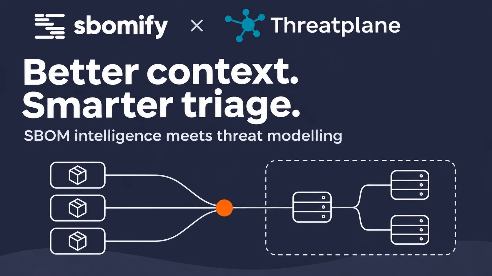

We are partnering with [Threatplane](https://threatplane.com/), the risk-based threat modelling company. The idea is simple: sbomify tells you what is in your software and which parts of it are vulnerable, and Threatplane tells you where that software sits and what is at stake if it is attacked. Put the two together and you can triage security work by real risk instead of by raw severity score.

> "We are super excited to partner with sbomify to give our customers more context to enable more effective triaging."
>
> — Jonny Tyers, Founder & Managing Director, Threatplane

## The Problem: Too Many Findings, Not Enough Context

If you generate SBOMs and scan them, you already know the pattern. Every release brings a long list of CVEs, each with a CVSS score, and the score is the only thing you have to sort by. So teams fix the 9.8s first, wherever they are.

But a CVSS score describes the vulnerability, not your system. It cannot know that:

- The component with the critical CVE only runs in a batch job on an isolated internal network, behind two trust boundaries.
- The "medium" finding sits in the parser that handles every unauthenticated request to your public API.
- One of those services processes payment data and the other renders an internal dashboard.

A CVSS 10 in a component that is only reachable from an internal service is not as urgent as a CVSS 7 on a public server. Anyone who has done triage by hand knows this. The trouble is that the context lives in people's heads, or in a threat model that nobody connects back to the SBOM.

Threatplane puts it well: "Too much security output. Not enough security insight."

## What Each Side Brings

**sbomify** is the system of record for what you ship. It collects SBOMs for your products, projects, and components, keeps them current release by release, scans them for known vulnerabilities, and applies VEX so that findings you have already assessed stay assessed. It answers _what is in this, and what is wrong with it?_

**Threatplane** models the system around that software. Its threat models capture the assets in scope, data flows, trust boundaries, third-party dependencies, and authentication points. It assesses threats with STRIDE, rates them by likelihood and impact, and ties each risk to business impact through its RROC™ framework: Revenue, Reputation, Operations, and Compliance. It answers _where is this exposed, and what happens to the business if it fails?_

## A Quick Threat Modelling Primer

If threat modelling is new to you, here is the vocabulary used in the rest of this post.

A **threat model** is a structured picture of a system from an attacker's point of view. It usually starts with a **data flow diagram (DFD)**: the processes, data stores, external entities, and **data flows** that make up the system. **Trust boundaries** are drawn wherever data crosses from one level of trust to another, such as from the public internet into your API, or from an application into its database. Everything an attacker can reach from outside is the **attack surface**.

Threats are then enumerated against each element, most commonly with **STRIDE**, the framework Microsoft introduced:

- **Spoofing:** pretending to be another user, service, or component.
- **Tampering:** modifying data or code without authorisation.
- **Repudiation:** performing an action that cannot be traced or proven.
- **Information disclosure:** exposing data to someone who should not see it.
- **Denial of service:** making a system unavailable to legitimate users.
- **Elevation of privilege:** gaining permissions you were never granted.

Other well-known methods include **PASTA** (Process for Attack Simulation and Threat Analysis), a risk-centric seven-stage process, **LINDDUN** for privacy threats, **attack trees**, and **DREAD** for scoring. Many teams also map threats to **MITRE ATT&CK** techniques. Whatever the method, each threat is rated by **likelihood and impact**, linked to the **threat actors** realistically interested in it, and answered with **preventive, detective, and corrective controls**. The output is a prioritised **risk register** and a remediation roadmap.

Notice what is missing: a threat model describes components and the paths between them, but it rarely knows which library versions are running inside each box, or which of them have a known CVE today. That is exactly what an SBOM provides.

Neither answer is complete without the other. A vulnerability list with no architecture gives you severity without exposure. A threat model with no component data gives you exposure without knowing what is actually running there.

## Joining the Two Halves

The link between the platforms is a mapping between assets: a sbomify product or component on one side, and the matching asset in the Threatplane threat model on the other. Your "payments-api" component in sbomify is the "Payments API" box inside the public trust boundary in Threatplane.

Once that mapping exists, every finding gets context it never had before:

1. sbomify reports a vulnerability in a component.
2. The mapping finds where that component sits in the threat model.
3. The threat model says whether that asset is internet-facing or internal, which data flows pass through it, which controls already protect it, and which business impact categories a compromise would hit.
4. The finding is ranked by actual risk, not by its base score alone. A remote code execution CVE becomes an _elevation of privilege_ or _tampering_ threat on a specific asset, with a specific path from the attack surface.

This complements other exploitability signals you may already use, such as EPSS, CISA's KEV catalogue, reachability analysis, and VEX statements. Those tell you how likely a vulnerability is to be exploited at all. The threat model tells you what happens if it is exploited _here_.

The result is a shorter, more honest list. The critical CVE in the isolated batch job can wait for the next maintenance window. The medium one in the public request path goes to the top.

It works the other way too. When a threat model flags an asset as high risk, sbomify can show exactly which components and versions run on it, and whether any of them have open findings. That turns a risk on a diagram into a concrete, actionable list.

## You Can Do This Today with an Agent

You do not have to wait for a bespoke integration. Both platforms expose their data programmatically: sbomify through its API, and Threatplane through its API and an integrated MCP server that works with Claude, Copilot, Gemini, and other compatible models.

So an AI agent can do the joining for you:

- Read the products and components in sbomify, along with their current vulnerability findings.
- Read the assets, trust boundaries, and risks in the Threatplane threat model.
- Propose a mapping between the two, which a human reviews and corrects once.
- Use that mapping to re-rank findings by exposure and business impact, and explain why each one landed where it did.

The mapping is the only manual step, and you only do it once per system. After that, as new releases land in sbomify and the threat model changes in Threatplane, the agent can keep the prioritised view current.

## From Context to a Signed VEX Statement

Re-ranking findings is only half of it. The other half is writing down what you decided, in a form your customers and auditors can read. That is what [VEX](/faq/how-do-i-use-vex/) (Vulnerability Exploitability eXchange) is for.

Until now, most VEX statements said one of two things: the product is not affected, because the vulnerable code is missing or unreachable, or it is affected and a fix is coming. Anything in between was hard to justify, so teams either patched everything or quietly sat on findings without explaining why.

A threat model changes that, because it supplies the missing argument: _where_ the vulnerable component lives. With sbomify and Threatplane joined up, an agent can draft the VEX statement and attach the reasoning from both sides. That covers the component and version from sbomify, plus the asset, trust boundaries, exposure, and business impact from Threatplane. A human then reviews it and signs it off. The agent does the legwork, and a person stays accountable for the decision.

That makes **accepting the risk** a realistic, documented outcome rather than an awkward silence. It depends on where the risk lives. The VEX standards do not have an "accepted risk" status, but each one has fields for exactly this decision:

- **CycloneDX VEX:** if the threat model shows the conditions for exploitation are not present, the analysis state is `not_affected`, with a justification such as `protected_at_perimeter` ("Attacks are blocked at physical, logical, or network perimeter"), `requires_environment`, or `protected_by_mitigating_control`. If the vulnerability is exploitable but the risk is acceptable for that asset, the state is `exploitable` with the response `will_not_fix`. The analysis `detail` records why.
- **CSAF 2.0:** the product is listed as `known_affected` with a remediation of category `no_fix_planned`, or as `known_not_affected` with a justification flag such as `vulnerable_code_cannot_be_controlled_by_adversary`.
- **OpenVEX:** the status is `affected` with an `action_statement` explaining the decision, or `not_affected` with a justification such as `vulnerable_code_cannot_be_controlled_by_adversary`.

The same CVE can therefore get different answers on different assets. On the internet-facing payments API it is `exploitable` and gets fixed this sprint. In the isolated batch job, the threat model shows no realistic attack path, and a signed statement accepts the risk until the next scheduled upgrade. sbomify ingests all three formats and applies the statements to your findings, so the decision shows up in your vulnerability counts and on your Trust Center.

Want help setting this up for your own products? [Contact sbomify sales](https://app.sbomify.com/enterprise-contact/) about your SBOM and vulnerability data, or [get in touch with Threatplane](https://threatplane.com/get-in-touch) about threat modelling your systems.

This is a good example of the whole being greater than the sum of its parts. Neither tool had to change what it does best. Joining their data is what produces the insight.

## Built for the Teams Doing the Work

This partnership is aimed at the people who actually triage findings:

- **Security teams** get a defensible, risk-based order of work they can explain to leadership.
- **Engineering teams** stop being asked to drop everything for scores that do not reflect their system.
- **Risk and compliance** get a line from a specific component, through a specific asset, to a specific business impact. That is the kind of evidence regulators and frameworks like the [Cyber Resilience Act](/cra/) increasingly expect.

## What's Next

We will be working with Threatplane to make the mapping easier to set up and keep in sync, and we will share worked examples as we go.

The standards are moving in the same direction. [CycloneDX](https://cyclonedx.org/) 2.0 will add support for expressing threat models, so the components in an SBOM and the threats, trust boundaries and data flows around them can be described in one machine-readable format. Today the mapping between the two sides is built by an agent or by hand. With threat modelling in CycloneDX 2.0, it can travel with the BOM itself, and that paves the way for even closer collaboration between sbomify and Threatplane.

If you already use both platforms, we would love to hear how you are combining them. If you are new to either, talk to the team on that side: sbomify for SBOM management, vulnerability data and VEX, Threatplane for threat modelling and risk assessment.


