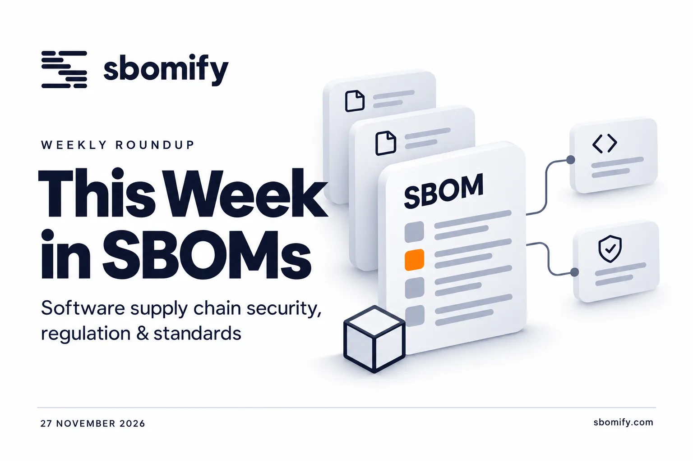

---

title: "This Week in SBOMs: Hex.pm Breached, Supermarket Fridges in KEV, and Germany's CRA Act Becomes Law"
description: "SBOM news for 21 to 27 November 2026: an unauthenticated RCE in the Hex.pm package registry, GitHub and CI/CD breaches at 1Password, Todoist and Defang, PolinRider in open-source pull requests, Danfoss refrigeration controllers in KEV after the European supermarket attacks, Ghostscript Upload2Shell and NFS2ROOT, exploited Drupal and GeoServer flaws, 15 KEV additions, Germany's CRA implementation act in the Bundesgesetzblatt, the FCC keeping SBOM disclosure on the Cyber Trust Mark label, MAS asking for cryptographic inventories, a stricter SPDX NTIA conformance checker, and new sbomify FAQ entries on linked releases, advisory IDs and VEX."
keywords: "This Week in SBOMs, SBOM news, Danfoss AK-SM 800A, IoTSF webinar, Cyber Resilience Act supermarket attacks, CVE-2023-25915, supermarket fridge hack, RDM refrigeration controllers, Hex.pm, CVE-2026-129514, 1Password, Todoist, Defang, SAP, PolinRider, CI/CD compromise, Ghostscript, Upload2Shell, CVE-2026-125396, NFS2ROOT, CVE-2026-99362, GPGME, CVE-2026-129975, zstd, libexpat, OpenSSL 4.1.1, CISA KEV, Drupal, Xen Orchestra, BGBl. 2026 I Nr. 355, German CRA act, ENISA SRP, NIS2, FCC Cyber Trust Mark, HBOM, MAS quantum-safe, cryptographic inventory, CBOM, Cyber Security and Resilience Bill, NTIA conformance checker 6.1.0, CycloneDX 2.0, PURL directory, ECMA-427, VERS, SPDX 3.1, VEX, sbomify FAQ"
categories:
  - news
tags: [sbom, this-week-in-sboms, supply-chain, ics, hbom, hex, elixir, ci-cd, github, ghostscript, linux, kev, cra, nis2, bsi, fcc, cbom, pqc, vex, spdx, cyclonedx, purl, vers]
tldr: "The Hex.pm package registry was taken over through an unauthenticated RCE (CVE-2026-129514). Hex found no modified packages, but its registry signing key has not been rotated yet, so it says to fetch only from repo.hex.pm. The same week, 1Password, Todoist and Defang disclosed breaches that ran through GitHub accounts or CI workflows, and PolinRider force-pushed a loader into open-source pull requests, where it ran in at least one release workflow. CISA put the Danfoss refrigeration controllers behind this autumn's European supermarket attacks into KEV, days after a quiet UK operation took thousands of exposed controllers from another maker offline. Germany's CRA implementation act was published in the Bundesgesetzblatt, though most of it applies only from 11 December 2027. The FCC proposed keeping 'does the manufacturer maintain an SBOM' on the front of the Cyber Trust Mark label, and MAS's quantum-safe consultation asking for cryptographic inventories closed. The SPDX NTIA conformance checker got stricter. And sbomify's FAQ now covers linked releases, advisory IDs and three ways VEX gets in."
author:
  display_name: Cowboy Neil
  login: Cowboy Neil
  url: https://sbomify.com
image: /assets/images/blog/this-week-in-sboms-2026-11-27-social.jpg
date: 2026-11-27
slug: this-week-in-sboms-2026-11-27
---

This instalment, number six in the series **This Week in SBOMs**, covers the period from **Saturday 21 through Friday 27 November 2026**. [The preceding entry](/2026/11/20/this-week-in-sboms-2026-11-20/) dealt with runtimes hidden inside other applications. Attention now turns to the build pipeline: a language registry and three software vendors experienced compromises via their source control or continuous integration environments, alongside multiple open-source projects. Regulatory developments were quiet owing to US Thanksgiving on Thursday, though Germany's CRA implementation act has formally become law, even if most provisions do not take effect until December 2027.

## The big one: Hex.pm, and a week of CI/CD breaches

On **23 November**, between 18:16 and 18:29 UTC, an attacker sent 69 malicious requests to [hex.pm](https://hex.pm/blog/security-incident-on-hexpm), the repository for Elixir and Erlang, issuing commands across six web servers. The flaw, catalogued as [CVE-2026-129514](https://insights.sbomify.com/CVE-2026-129514/) with a CVSS score of 10.0, existed within the process used by hex.pm to interpret unauthenticated request bodies formatted as Erlang terms via `Plug.Crypto.non_executable_binary_to_term/2`; this approach "blocks most potentially harmful terms, but allows struct values through". Hex says it found no evidence that packages had been modified. Nevertheless, "because database reads are not logged, we cannot rule out that the attacker accessed data stored in the database, including email addresses, password hashes, API key hashes, 2FA secrets". By 24 November, Hex had "rotated every credential the attacker could have read, including the database password, except the registry signing key and a few low-impact secrets". Hex is "building a new registry signing system that supports key rotation". Until this deploys, a valid registry signature offers less assurance than normal, which explains why Hex advises not to "trust third-party mirrors and fetch packages only from repo.hex.pm". ([THN](https://thehackernews.com/2026/11/hackers-exploited-cvss-100-hexpm-rce.html), [SecurityWeek](https://www.securityweek.com/hex-package-manager-warns-of-potential-data-breach/), [HN](https://news.ycombinator.com/item?id=50629149))

Hex was not the sole target. **1Password** [said](https://1password.com/blog/update-on-nov-2026-security-incident) on 25 November that a malicious actor gained entry to an employee's corporate GitHub account, deploying harmful code to backend services. This intruder "copied source code from private repositories and gained access to our CI/CD system"; the vaults remained untouched. It was the week's top security story on [HN](https://news.ycombinator.com/item?id=50644817). **Todoist** [says](https://www.todoist.com/help/todoist/get-started/security-incident-in-november-2026-cG0EIACNU) that between 22 and 23 November a threat actor "used a stolen credential associated with our version control system to modify automated workflows in three repositories and obtain additional credentials". **Defang** [writes](https://defang.io/blog/post/security-incident-november-2026/) that "Our production environment trusted release tags, so their code ran in our CI with access to our production credentials". **SAP** confirmed it "identified suspicious activity" but found "no evidence of unauthorized access to customer business data" ([BleepingComputer](https://www.bleepingcomputer.com/news/security/sap-confirms-security-incident-after-suspicious-github-activity/)). German media outlets reported that source code on GitHub was copied and altered, while [The Record](https://therecord.media/sap-germany-cyberattack-github) and [SecurityWeek](https://www.securityweek.com/sap-confirms-cyberattack-source-code-reportedly-compromised/) noted that signing keys were swapped. SAP has not validated either assertion.

**Why this matters for SBOM/VEX practitioners:** an SBOM enumerates the components comprising a build; it cannot establish whether the build, registry, or signing key is trustworthy. If you rely on Hex packages, verify that every Hex, Mix, rebar3, and Gleam client within your CI fetches from repo.hex.pm until the revised signing infrastructure goes live, and record which mirror each build used. Regarding your internal pipeline, take Defang's lesson to heart: any system able to generate a release tag can execute code using production credentials. Provenance attestations offer some utility. They link an artefact and its SBOM to the specific commit and workflow run that produced it, allowing a customer to confirm that a release originated from your pipeline and from which commit. However, they cannot distinguish a malicious tag from a legitimate one if the attacker operated your own workflow, as occurred at Defang. Protected tags and reviewed release commits have to cover that part.

## Security news that mattered

**Supermarket fridge controllers: Danfoss in KEV, and the UK's near miss (25 November).** On 25 November, CISA incorporated three vulnerabilities found in Danfoss AK-SM 800A refrigeration units into KEV: [CVE-2023-25914](https://insights.sbomify.com/CVE-2023-25914/) involving path traversal, and [CVE-2023-25915](https://insights.sbomify.com/CVE-2023-25915/), which "could allow a remote attacker to run arbitrary commands", alongside [CVE-2025-41450](https://insights.sbomify.com/CVE-2025-41450/) concerning improper authentication. The first two are due on 28 November, three days later, following an [ICS advisory](https://www.cisa.gov/news-events/ics-advisories/icsa-26-328-03) issued by CISA on 24 November regarding the AK-SM 8xxA series. These units were the target of recent attacks against European supermarkets this autumn: the [BBC](https://www.bbc.co.uk/news/articles/c6eq49zyx7p4o) noted incidents in France on 11 and 12 October where "Danfoss temperature control systems were targeted", alongside events affecting seven nations on 1 and 2 November. On 20 November, the day before this week's window opened, the BBC and [Pen Test Partners](https://www.pentestpartners.com/security-blog/the-fridge-hack-uk-supermarkets-narrowly-avoided/) revealed a quieter operation in the UK. There, controllers from a different manufacturer, RDM, had "a related vulnerability, though not identical". The NCSC, Defra, and the Food Standards Agency engaged with operators to address this; as reported by the BBC, thousands of devices were disconnected from the internet, with some units having their cables pulled. RDM "disputes the critical nature of the vulnerabilities", stating it has "deployed first patch releases" and detected no indicators of malicious activity. Pen Test Partners is not yet releasing further details. _Why it matters:_ Pen Test Partners recommends to "Get the controllers off the public internet and apply the firmware update". Implementing this guidance presupposes knowledge of your installed controllers, their firmware versions, and the entities with remote access. This necessitates maintaining a hardware and firmware inventory, an HBOM plus a firmware SBOM—a difficult task for equipment installed by contractors. Under the CRA, these units are products with digital elements; consequently, from December 2027, their manufacturers will be required to provide an SBOM for the firmware.

The question of whether the CRA would have halted this activity was explored in an IoT Security Foundation [webinar](https://www.youtube.com/watch?v=l3iiJq3kBhw) held on 18 November, titled "European supermarket cyberattacks: Could the CRA have prevented them?". The session opens with a talk by Viktor Petersson, founder of sbomify, so treat it as house content, followed by a panel featuring Ken Munro from Pen Test Partners, whose team worked on the UK disclosure above.



**PolinRider enters open-source release pipelines (25 to 27 November).** [StepSecurity](https://www.stepsecurity.io/blog/polinrider-malware-open-source-pull-requests) reports that an account force-pushed a Python loader into pull-request branches across projects such as AsyncAPI, Jaeger, CircuitVerse and Open Food Facts. Within CircuitVerse, the code executed inside the release workflow, and maintainers "deleted the 40 installers the workflow published". THN, referencing data from Apiiro, puts the broader campaign at "over 7,600 GitHub repositories" and states there is "no evidence" of distribution through PyPI or npm ([THN](https://thehackernews.com/2026/11/north-korea-linked-polinrider-poisons.html)). _Why it matters:_ a build artefact generated from a tainted pull-request branch presents an SBOM that appears clean. Rebuild and re-issue the SBOM for any deliverables produced by an impacted workflow.

**Ghostscript Upload2Shell (21 November).** [pwn.ai](https://pwn.ai/upload2shell) released [CVE-2026-125396](https://insights.sbomify.com/CVE-2026-125396/), describing a use-after-free flaw within the Type 1 font loader capable of bypassing `-dSAFER`. Affected paths include ImageMagick, Pillow, libvips, and CUPS, among others. Although the vulnerability was addressed in Ghostscript version 10.08.0 back in September, some distributions still listed it as unfixed on 12 November. The post emphasises: "Looking only for explicit Ghostscript calls in application code misses both kinds of indirect invocation." ([oss-security](https://www.openwall.com/lists/oss-security/2026/11/21/2), [THN](https://thehackernews.com/2026/11/researchers-demonstrate-ghostscript.html), [HN](https://news.ycombinator.com/item?id=50592097)) _Why it matters:_ Ghostscript is frequently not a direct dependency in the package-manager sense. Tools such as ImageMagick and Pillow may pass EPS and PDF files to the `gs` utility installed on the system. A Software Bill of Materials (SBOM) generated from your lockfile will overlook this, whereas one derived from container images or host packages will identify it. If your scope is limited to application dependencies alone, this flaw shows the gap.

**NFS2ROOT in the Linux kernel (25 November).** [OpenSec](https://opensec.in/blog/nfs2root-cve-2026-99362) details [CVE-2026-99362](https://insights.sbomify.com/CVE-2026-99362/), a pre-authentication heap overflow in nfsd that OpenSec chains to root. This issue originates from Linux 3.16 and is resolved in versions 6.12.117, 6.18.61, 7.3.2, and 7.4-rc1. ([HN](https://news.ycombinator.com/item?id=50647161)) On oss-security, Hanno Böck [observed](https://www.openwall.com/lists/oss-security/2026/11/25/9) that Ubuntu remained without a patch for NoisyTCP, [CVE-2026-99288](https://insights.sbomify.com/CVE-2026-99288/), nine days after its publication, nor had it addressed the KVM host escape [CVE-2026-99312](https://insights.sbomify.com/CVE-2026-99312/). _Why it matters:_ Distribution kernels often contain backports; therefore, match against the distribution package version rather than the upstream version string. NFS2ROOT also presents a valid VEX scenario: a host that does not run the NFS server can be marked as unaffected, provided this status is recorded per deployment instead of being assumed.

**Also of interest:**

- **WordPress.org** held back backdoored versions of six WP Connect plugins on 22 November via its new release hold, according to [THN](https://thehackernews.com/2026/11/wordpress-blocks-six-backdoored-wp.html) referencing Wordfence ([CVE-2026-135202](https://insights.sbomify.com/CVE-2026-135202/)). We have not checked the Wordfence article directly.
- **NuGet:** [THN](https://thehackernews.com/2026/11/13-malicious-nuget-packages-turn-fake.html) reports 13 malicious packages pushed through fake .NET job assessments; several ran their payload at build time through MSBuild `.targets` files. All have been removed from the gallery. A build-time payload runs before any SBOM of the output exists, so check build hosts too.
- **Exploited open-source applications:** Drupal warned of a new "highly critical" flaw, [CVE-2026-136716](https://insights.sbomify.com/CVE-2026-136716/), under active exploitation ([THN](https://thehackernews.com/2026/11/drupal-warns-of-new-highly-critical.html), 26 November), two days after Drupal core [CVE-2026-132165](https://insights.sbomify.com/CVE-2026-132165/) entered KEV. Two GeoServer flaws were exploited from 25 November according to [THN](https://thehackernews.com/2026/11/hackers-exploit-two-geoserver-flaws-as.html) citing watchTowr.
- **Patches:** zstd 1.6.0 resolves [CVE-2026-124851](https://insights.sbomify.com/CVE-2026-124851/), allowing up to 64 KiB of internal buffer disclosure ([oss-security](https://www.openwall.com/lists/oss-security/2026/11/24/1)). libexpat 2.11.0 addresses [CVE-2026-124317](https://insights.sbomify.com/CVE-2026-124317/), [CVE-2026-128241](https://insights.sbomify.com/CVE-2026-128241/) and [CVE-2026-134703](https://insights.sbomify.com/CVE-2026-134703/) ([oss-security](https://www.openwall.com/lists/oss-security/2026/11/23/19)). Flatpak 1.18.6 corrects a setuid-file issue and a sandbox breakout ([oss-security](https://www.openwall.com/lists/oss-security/2026/11/24/15)). Both zstd and expat are often vendored or statically linked, where an SBOM built from package metadata will not see them.
- **OpenSSL** [confirmed](https://www.openwall.com/lists/oss-security/2026/11/24/14) releases 4.1.1, 4.0.4 and 3.5.10 for 1 December; "The highest severity issue fixed in these releases is Moderate."
- **GitLab** 19.6.2, 19.5.9 and 19.4.11 (25 November) [switch](https://docs.gitlab.com/releases/patches/patch-release-gitlab-19-6-2-released/) the included nginx to 1.31.9 and resolve the bundled GPGME double free, [CVE-2026-129975](https://insights.sbomify.com/CVE-2026-129975/). This settles last week's query regarding GitLab's bundled nginx. nginx itself released 1.31.10 and 1.30.8 on 23 November for [CVE-2026-132779](https://insights.sbomify.com/CVE-2026-132779/) ([nginx.org](https://nginx.org/en/security_advisories.html)).
- **Updates:** Java4Shell, [CVE-2026-114938](https://insights.sbomify.com/CVE-2026-114938/), remains absent from KEV. CISA-ADP cut its score for OpenSSL [CVE-2026-121481](https://insights.sbomify.com/CVE-2026-121481/) from 9.8 to 5.9 on 20 November, just before the window, which settles last week's question. We discovered no remedy or CVE for the SCTP flaw underlying NGINX2Root ([CVE-2026-123007](https://insights.sbomify.com/CVE-2026-123007/) and [CVE-2026-123633](https://insights.sbomify.com/CVE-2026-123633/) cover the nginx half), nor a verified cause for the agent-framework PyPI breach ([MAL-2026-20101](https://insights.sbomify.com/MAL-2026-20101/), [PYSEC-2026-4388](https://insights.sbomify.com/PYSEC-2026-4388/)).

**KEV.** The catalogue gained fifteen entries between 23 and 25 November, reaching version 2026.11.25 by Friday. Four concern open-source software: MONAI Label [CVE-2026-133968](https://insights.sbomify.com/CVE-2026-133968/), Drupal core [CVE-2026-132165](https://insights.sbomify.com/CVE-2026-132165/), Xen Orchestra [CVE-2026-133469](https://insights.sbomify.com/CVE-2026-133469/), and the Idunno AntiCsrf library [CVE-2026-131914](https://insights.sbomify.com/CVE-2026-131914/), which, according to [THN](https://thehackernews.com/2026/11/hackers-exploit-critical-aspnet-anti.html), received no patches after 2008. On 24 November, Optimizely [CVE-2026-132224](https://insights.sbomify.com/CVE-2026-132224/), behind the snippet hijack mentioned last week, was added to the list. The remaining items comprise the Danfoss controllers cited earlier, alongside products from Juniper ([CVE-2026-103406](https://insights.sbomify.com/CVE-2026-103406/)), Mitel ([CVE-2026-133275](https://insights.sbomify.com/CVE-2026-133275/), [CVE-2026-133303](https://insights.sbomify.com/CVE-2026-133303/), [CVE-2026-133311](https://insights.sbomify.com/CVE-2026-133311/), [CVE-2026-133323](https://insights.sbomify.com/CVE-2026-133323/), [CVE-2026-133324](https://insights.sbomify.com/CVE-2026-133324/)) and N-able ([CVE-2026-134624](https://insights.sbomify.com/CVE-2026-134624/)). When a library has been abandoned, its existence can often only be detected through an SBOM, since no advisory will be published. The complete list is available at [insights.sbomify.com/exploited](https://insights.sbomify.com/exploited/), while further background details are provided in our [KEV explainer](/2025/12/30/what-is-kev-cisa-known-exploited-vulnerabilities/).

## CRA

**Germany's implementation act for the CRA is now law (25 November).** This legislation, dated 20 November, was [published](https://www.recht.bund.de/bgbl/1/2026/355/VO.html) via BGBl. 2026 I Nr. 355. It adds a chapter covering products with digital elements to the BSI Act and identifies the BSI as "die zuständige nationale Marktüberwachungsbehörde". Although various news sources suggest most provisions commenced on 26 November, the [text](https://www.recht.bund.de/bgbl/1/2026/355/regelungstext.pdf?__blob=publicationFile&v=1) offers no confirmation of this timeline. Only a restricted set of clauses become active immediately upon promulgation; for instance, § 66 pertains to notification and accreditation, enabling Germany to initiate notifications for conformity assessment bodies. Otherwise, "Im Übrigen tritt dieses Gesetz am 11. Dezember 2027 in Kraft." _Why it matters:_ the organisation responsible for reviewing German manufacturers' SBOMs is also the author of [TR-03183](/compliance/bsi-tr-03183/), and its penalty regime will align with the CRA's SBOM mandate starting December 2027. The early implementation of § 66 is also significant: in an [answer to the Bundestag](https://dserver.bundestag.de/btd/21/092/2109292.pdf) from 19 November, the government stated that nine entities had applied to DAkkS for CRA accreditation, with none accredited at that time. Critical products and important class II products will need such accredited bodies for conformity assessment.

**Eclipse ORC: PURLs in attestations.** An open [pull request](https://github.com/orcwg/cra-attestations/pull/45) lodged on 21 November suggests incorporating Package URLs into the attestation template, observing that "SBOMs usually record a component's package rather than its repository". If adopted, an open-source attestation could be directly cross-referenced with an SBOM entry.

**Continued quiet on ENISA.** No fresh updates were released by the agency. The SRP website still states that documentation for version 1.4 is "currently being updated". On 26 November, the Commission's [manufacturers page](https://digital-strategy.ec.europa.eu/en/policies/cra-manufacturers) added Spain's INCIBE-CERT to its roster of national resources. We observed no new progress concerning EN 40000-1-3; background material remains accessible on our [CRA page](/compliance/eu-cra/).

## NIS2

Activity was minimal. France's resilience law is pending a joint committee session, for which no date has been set ([Sénat](https://www.senat.fr/dossier-legislatif/pjl24-033.html)), and we found no infringement proceedings during this reporting period. For more information, consult our [NIS2 page](/compliance/eu-nis2/).

## CISA and US regulators

**FCC wants the SBOM question kept on the front of the label (23 November).** A [Federal Register notice](https://www.federalregister.gov/documents/2026/11/23/2026-23812/cybersecurity-labeling-for-internet-of-things) regarding the U.S. Cyber Trust Mark encapsulates a public statement from 27 October. The CTA-2120 standard locates HBOM/SBOM details on the label's secondary tier. The Bureau asserts, "we propose to decline to remove this data element (whether the manufacturer maintains an HBOM/SBOM) from Layer 1", while noting that "many consumers may not understand the purpose of an HBOM/SBOM". Comments are due by 23 December. _Why it matters:_ for labelled IoT hardware, "do you maintain an SBOM" would be a yes/no question on the label's first page. Confirming this signals the capability to generate one.

Beyond KEV and standard ICS alerts, CISA published nothing further. Searches of the Federal Register using terms like "cryptographic inventory", "post-quantum", or "secure software development" returned no additional entries. The [Minimum Elements](/compliance/cisa-minimum-elements/) remain as they were.

## Other regulators

**Singapore MAS: cryptographic inventories (23 November).** The period for submissions on the MAS [consultation](https://www.mas.gov.sg/-/media/mas-media-library/publications/consultations/trpd/2026/p019-2026-november-2026-consultation-paper-on-quantumsafe-migration-guidance-and-timelines-for-the-f.pdf) concerning a transition to quantum-resistant standards has now closed. MAS proposes that financial institutions maintain "a comprehensive inventory of cryptographic assets, covering at minimum the algorithms, key lengths and protocols in use", with an indicative target date of the end of 2027 for migration plans. Given the UK guidance we covered last week, this means two financial overseers are outlining what effectively amounts to a [CBOM](/faq/what-is-a-cbom/). Both documents remain consultations, not yet binding regulations.

**UK Cyber Security and Resilience Bill (24 November).** The Commons accepted most amendments from the Lords but rejected two further proposals, including a review provision meant to address "the management of supply chain risks" ([Hansard](https://hansard-api.parliament.uk/debates/debate/9696CEE9-A8C3-449D-9B15-89FA9F00CF8E.json)). The Lords are set to revisit these matters on 7 December. Royal Assent has not yet been bestowed, and the bill contains no requirement for an SBOM.

On 24 November, BSI [confirmed](https://www.bsi.bund.de/DE/Service-Navi/Presse/Alle-Meldungen-News/Meldungen/2026/OSCAL-bleibt_261124.html) that OSCAL continues to be its chosen format for machine-readable security specifications. We detected no fresh developments from METI, CERT-In or ASD, though several of their websites were inaccessible to us during our checks.

## Standards

**The SPDX NTIA conformance checker got stricter (27 November).** [v6.1.0](https://github.com/spdx/ntia-conformance-checker/releases/tag/v6.1.0) now alerts users that "Some SBOMs that passed 6.0.0 may now fail". A missing element at either end of a relationship will now trigger failure across all validators, including NTIA, FSCT3 and BSI, and `SPDXRef-DOCUMENT DESCRIBES A` in isolation no longer serves as adequate proof of a dependency link. _Why it matters:_ should your SPDX generator produce only `DESCRIBES`, expect failures in continuous integration pipelines following an upgrade.

**CycloneDX 2.0 remains unavailable.** The latest release is still version 1.7.2. On 27 November, a maintainer [stated](https://github.com/CycloneDX/specification/issues/1254) that "WE are currently finalizing CycloneDX 2.0". This week's merges were editorial only. The [cyclonedx-python-lib 11.13.0](https://github.com/CycloneDX/cyclonedx-python-lib/releases/tag/v11.13.0) update added support for 1.7.2 and included the component `modelCard` field.

**PURL and VERS.** The architecture for the PURL registry was solidified in a [decision document](https://github.com/package-url/purl-spec/pull/1073) from 21 November, which changed the namespace registry's name to a "PURL directory". Development on [ECMA-427 second-edition edits](https://github.com/Ecma-TC54/ECMA-427/pull/114) is ongoing; a commit dated 24 November described VERS as "ECMA-436", though Ecma has not yet confirmed this designation.

**SPDX.** The version is still at 3.1 RC1. Proposal [#1498](https://github.com/spdx/spdx-3-model/issues/1498) recommends dropping MD5 and SHA-1 within `HashAlgorithm`, a suggestion that faced pushback on the grounds that SPDX should "record facts about the system".

## The wider landscape

- **Dependency-Track:** Issue [#8075](https://github.com/DependencyTrack/dependency-track/issues/8075) notes that uploading an older CycloneDX VEX version overwrites a newer one, observed in 4.14.7. Maintainers have yet to confirm this. Until then, restrict VEX uploads to a single pipeline or verify the resulting version.
- **Sigstore:** [sigstore-python 4.6.0](https://github.com/sigstore/sigstore-python/releases/tag/v4.6.0), issued on 22 November, includes Ed25519 certificate verification and now uses the OS certificate store.
- **OpenVEX:** Issues [#78](https://github.com/openvex/spec/issues/78) and #80 show that several examples are invalid JSON or do not meet the schema requirements.
- **OpenSSF** launched a Japan working group; TAC activity was minimal. No new SBOM papers emerged on arXiv.

## House news: new sbomify FAQ entries

This column excludes vendor announcements, reserving this section for our own updates. On 26 November we updated three FAQ entries to match the revised walkthrough videos:

- [How do I use VEX?](/faq/how-do-i-use-vex/) now outlines the three entry points for a VEX statement into sbomify: automatic generation during vulnerability triage, a drafted proposal from an AI agent awaiting human sign-off, or uploading a file sourced from another tool. The guide finishes on the public release page, where the finding is shown as suppressed.
- [How do I create a software release?](/faq/how-do-i-create-a-software-release/) now features a **Ships with** section. A release can link the release of another product it includes, such as firmware or a runtime image, ensuring their SBOMs are folded into the consolidated SBOM.
- [How do I publish a security advisory?](/faq/how-do-i-publish-a-security-advisory/) explains how to set up the advisory ID prefix and the initial number for each year to avoid collisions with identifiers you issued elsewhere.

The material now also includes dedicated pages: [Vulnerability Management and VEX](/features/vulnerability-management/) and [AI Agents](/features/ai-agents/). _Why it matters:_ this week's reports on Ghostscript and fridge controllers both concern components that were not listed. If your product bundles a runtime or firmware you also ship separately, its SBOM should accompany the release.

## What to watch next week

- Hex's refreshed registry signing infrastructure and client updates, plus 1Password's promised root-cause analysis.
- OpenSSL releases planned for 1 December.
- Information on RDM controller vulnerabilities, should Pen Test Partners disclose them, and whether additional refrigeration controllers reach KEV.
- The EU Telecom Council gathering on 1 December, where the Cybersecurity Act revision and NIS2 amendments appear only under any other business.
- The House of Lords' examination of the UK bill on 7 December.
- CycloneDX 2.0, and the possible approval of VERS as ECMA-436 at the December Ecma General Assembly.

_This Week in SBOMs concentrates on regulation, standards, and the open-source community, omitting vendor product announcements and promotional content while covering vendors' own security incidents. Releases from our own organisation are flagged as house news when cited. Have you noticed anything we overlooked? Contact us._
